  

 

  I'm Finn, the founder of <a href="https://studiomori.ai">Studio Mori</a>. 
  About six years of building things, mostly in code. 
  These days also VFX and editing in After Effects, modelling in Blender, and making Roblox games.

 

  

<h3 align="center">Studio Mori</h3>

  An AI agent for your computer. One agent for all of your work, free on Mac and Windows.

  <picture>
    <source media="(prefers-color-scheme: dark)" srcset="assets/mori-typing-dark.svg">
    
  </picture>

  <a href="https://studiomori.ai">studiomori.ai</a>
  &nbsp;·&nbsp;
  <a href="https://x.com/StudioMoriAI">@StudioMoriAI</a>
  &nbsp;·&nbsp;
  <code>npx studio-mori</code>

 

  <a href="https://x.com/fax000x">@fax000x</a>
  &nbsp;·&nbsp;
  <a href="mailto:finn@studiomori.ai">finn@studiomori.ai</a>
  &nbsp;·&nbsp;
  <a href="https://faxo.dev">faxo.dev</a>

  Off the clock: Bleach, manga and figures, trading.

