<picture>
  <source media="(prefers-color-scheme: dark)" srcset="assets/header-v3-dark.svg">
  
</picture>

About six years of code. I also do VFX in After Effects, model in Blender and build Roblox games.

### Studio Mori

An AI agent for your computer. One agent for all of your work.

<picture>
  <source media="(prefers-color-scheme: dark)" srcset="assets/mori-typing-v3-dark.svg">
  
</picture>

**Install:** `npx studio-mori`, or the download at [studiomori.ai/download](https://studiomori.ai/download) 
**Runs on:** Mac, Windows, iPhone and Chrome 
**Cost:** free on your own keys or local models, with plans for cloud models and heavier use 
**Links:** [studiomori.ai](https://studiomori.ai) · [Docs](https://studiomori.ai/docs) · [@StudioMoriAI](https://x.com/StudioMoriAI)

### Vyridian

Builds tools, systems, automations and compute for businesses. [vyridian.org](https://www.vyridian.org)

### Contact

X [@fax000x](https://x.com/fax000x) · Discord `finyn` · [finn@studiomori.ai](mailto:finn@studiomori.ai) · [faxo.dev](https://faxo.dev)
